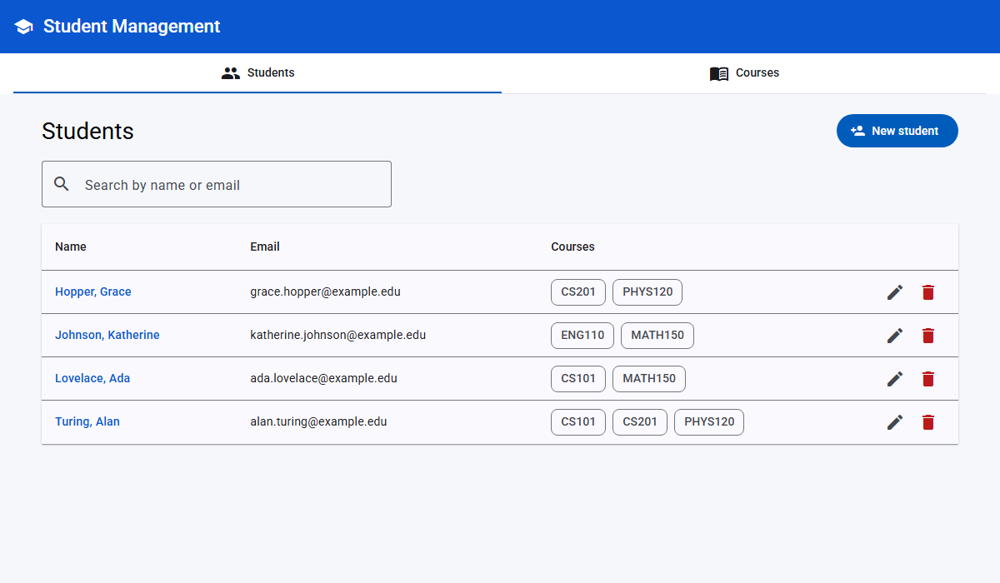

# Student Management

A full-stack app for managing students and the courses they're enrolled in, built as **one Spring Boot project**. The Angular web UI lives inside the project at `src/main/web`, and the Maven build compiles it into the application, so a single command builds and runs everything and the UI and REST API are served together from http://localhost:8080.

- **Server:** Java 21, Spring Boot 4.1 (Spring MVC REST services, Spring Data JPA, Bean Validation, RestTemplate), H2 embedded database
- **Web UI:** Angular 18 (standalone components), Angular Material 18, RxJS, in `src/main/web`. The Public Sans font and Material Icons are bundled with the app, so the UI makes no requests to outside sites.
- **Build:** Maven (wrapper included). The `frontend-maven-plugin` downloads Node, runs `npm install` and `ng build`, and writes the UI into `target/classes/static`, where Spring Boot serves it.

Each student can be enrolled in many courses, and each course has many students. Both students and courses support full create, read, update, and delete.



The layout has a sidebar for navigation (Students, Courses, and shortcuts to create a new student or course) and routed **Students / Courses** tabs above the content. On screens narrower than 960px the sidebar becomes a slide-out menu, the tabs carry the navigation, and tables scroll sideways.

## Features

| Requirement | Where it is |
|---|---|
| CRUD operations | Students and courses: list, view, create, edit, and delete. Enroll and drop a student from a course. |
| Routing | `/students`, `/students/new`, `/students/:id`, `/students/:id/edit`, the same four for `/courses`, and a 404 page. Routes are lazy-loaded, and route params are bound to component inputs. |
| Multiple tabs with modal confirmation | The top-level **Students / Courses** tabs are routed tabs. Detail pages have inner tabs (**Profile / Courses** and **Details / Roster**). Leaving a form with unsaved changes, by switching tabs or using the sidebar, opens a **Discard changes?** modal through a `CanDeactivate` guard. Every delete or drop asks for confirmation in a modal. |
| Error handling | **Server:** `@RestControllerAdvice` returns one consistent JSON error shape (`status`, `message`, `path`, `fieldErrors`) for validation (400), not found (404), duplicates and business rules (409), unsupported content types (415), malformed JSON, type mismatches, and unexpected errors (500). **Web UI:** an HTTP interceptor turns every failure into an `AppError`. Network and 5xx errors show a global snackbar, field errors from the server appear under the matching form field, and list/detail pages show an inline error banner with a Retry button. |
| Multi-component communication | Parent to child through `@Input` / `@Output` (`StudentListComponent` → `StudentTableComponent`, `ErrorBannerComponent`). Shared RxJS stores carry state between pages. A `DataChangeBus` lets the stores refresh each other: enrolling a student updates the course's enrolled count, and deleting a course updates the students' course lists. |
| Form handling | Reactive forms with client-side validators that match the backend rules (required, max length, email, date in the past, course-code pattern, credits 1–6, capacity at least the current enrollment). Server-side errors are mapped back onto the form. |
| State management with RxJS | `StudentStore` and `CourseStore` keep state in a `BehaviorSubject` and expose `students$`, `loading$`, and `error$` streams. Search uses `debounceTime`, `distinctUntilChanged`, and `switchMap`, so stale responses are dropped. |
| Backend CRUD, validation, exceptions, transactions | `@Transactional` services. Creating or updating a student together with its course list is atomic: if any course is missing or full, nothing is saved. Deleting a course drops all its enrollments in the same transaction. Enrolling locks the course row (`SELECT ... FOR UPDATE`), so simultaneous enrollments can't overbook a course. `@Version` makes conflicting concurrent updates to the same row fail with a 409 instead of silently overwriting each other. |
| RestTemplate | `StudentManagementClient` (in `client/`) is a Java client for every REST endpoint, built on Spring's `RestTemplate`. It sends and receives the same DTOs the server uses and turns error responses into an `ApiClientException` that carries the server's message and field errors. The end-to-end tests call the running API through this client, and `StudentManagementClientTest` unit-tests it against a mock server. See [Calling the API from Java](#calling-the-api-from-java-resttemplate). |
| Backend unit tests | 65 tests: Mockito service tests, `@WebMvcTest` tests for both controllers and the error handling, `@DataJpaTest` repository tests, RestTemplate client tests, full HTTP integration tests (including concurrent enrollments), and tests that the UI is served correctly. |

## Prerequisites

- **JDK 21 or newer.** The project compiles for Java 21, so an older JDK fails with `release version 21 not supported`. Check with `java -version`.
- **Port 8080 free.**

That's all. You don't need Maven, Node.js, or the Angular CLI installed: the Maven Wrapper downloads Maven, and the build downloads its own copy of Node into `.node/` the first time it runs.

## Running locally

From the project folder:

```bash
./mvnw spring-boot:run          # macOS / Linux
```

```powershell
.\mvnw.cmd spring-boot:run      # Windows (PowerShell or Command Prompt)
```

Open http://localhost:8080. This one command builds the Angular UI, starts the server, and serves the UI and the REST API (`/api/...`) together. The first run takes a few minutes while it downloads Maven, Node, and the npm packages; later runs are faster. Stop the app with `Ctrl+C`.

Refreshing the page or opening a deep link such as http://localhost:8080/students/1/edit works, because the server sends client-side routes to `index.html`. Unknown `/api/...` paths still return a JSON 404.

On the first start the app creates an H2 database file in `data/` and loads sample students and courses. To start over with fresh data, stop the app and delete that folder.

- H2 console: http://localhost:8080/h2-console (JDBC URL `jdbc:h2:file:./data/studentdb`, user `sa`, empty password)

### Build a runnable jar

```bash
./mvnw clean package
java -jar target/student-management-0.0.1-SNAPSHOT.jar
```

The jar contains the server and the compiled UI.

### Working on the UI with live reload (optional)

When you're changing Angular code, you can run the Angular dev server next to the running app for instant reloads:

```bash
./mvnw spring-boot:run -Dskip.npm -Dskip.installnodenpm   # server only, on :8080
cd src/main/web
npm install
npm start                                                 # UI on :4200, proxies /api to :8080
```

Then open http://localhost:4200. This needs Node.js 18.19+, 20.11+, or 22 installed locally. The `-Dskip.npm -Dskip.installnodenpm` flags skip the UI build in any Maven command. In PowerShell, quote them: `"-Dskip.npm" "-Dskip.installnodenpm"`.

## Calling the API from Java (RestTemplate)

`StudentManagementClient` wraps every endpoint in a typed Java method. Inside this app it is a Spring bean pointing at `app.client.base-url` (`http://localhost:8080` by default). To call another server, create one yourself:

```java
StudentManagementClient client = new StudentManagementClient(restTemplateBuilder, "http://localhost:8080");

CourseResponse cs101 = client.createCourse(new CourseRequest("CS101", "Intro to Programming", null, 4, 30));
StudentResponse ada = client.createStudent(
        new StudentRequest("Ada", "Lovelace", "ada@example.edu", null, Set.of(cs101.id())));

try {
    client.enroll(ada.id(), cs101.id());           // already enrolled
} catch (ApiClientException ex) {
    ex.getStatus();       // 409 CONFLICT
    ex.getMessage();      // "Student is already enrolled in CS101"
    ex.getFieldErrors();  // per-field validation messages, if any
}
```

## Running tests

```bash
./mvnw test                   # 65 backend tests
```

`StudentApiIntegrationTest` starts the app on a random port and drives it through `StudentManagementClient`. `WebUiIntegrationTest` checks that the built UI is served from `/`, that deep links fall back to `index.html`, and that API and missing-file 404s are left alone. It is skipped when the UI build is turned off with `-Dskip.npm`.

Web UI unit tests (7 tests; need Node.js and Chrome installed):

```bash
cd src/main/web
npm test -- --watch=false --browsers=ChromeHeadless
```

## Troubleshooting

| Problem | Fix |
|---|---|
| `npm error code EPERM ... operation not permitted, open '...package-lock.json'` on Windows | Another program is holding the file. Most often this is OneDrive syncing the project folder. Stop any running build, pause OneDrive syncing (OneDrive icon → ⚙ → Pause syncing), and run again. For a lasting fix, keep the project outside OneDrive, for example in `C:\dev\student-management`. |
| `release version 21 not supported` | Install JDK 21 or newer and make sure `java -version` shows it (set `JAVA_HOME` if an older JDK comes first). |
| `Port 8080 was already in use` | Stop the other app using 8080 (often an earlier run of this one), or start on another port: `./mvnw spring-boot:run -Dspring-boot.run.arguments=--server.port=8081`. |
| `./mvnw: Permission denied` (macOS / Linux) | Run `chmod +x mvnw` once. |
| The UI shows old screens after pulling changes | Rebuild with `./mvnw clean spring-boot:run`, then hard-refresh the browser (`Ctrl+Shift+R`). |

## REST API

Base URL: `http://localhost:8080/api`

| Method | Path | Description |
|---|---|---|
| GET | `/students?search=` | List students, optionally filtered by name or email |
| GET | `/students/{id}` | Get one student with their courses |
| POST | `/students` | Create a student (optionally with `courseIds`) |
| PUT | `/students/{id}` | Update a student. `courseIds` replaces the enrollments; if omitted or null, they stay as they are |
| DELETE | `/students/{id}` | Delete a student |
| PUT | `/students/{id}/courses/{courseId}` | Enroll a student in a course |
| DELETE | `/students/{id}/courses/{courseId}` | Drop a student from a course |
| GET | `/courses` | List courses with enrolled counts |
| GET | `/courses/{id}` | Get one course |
| GET | `/courses/{id}/students` | Course roster |
| POST | `/courses` | Create a course |
| PUT | `/courses/{id}` | Update a course |
| DELETE | `/courses/{id}` | Delete a course and remove it from all students |

Example request body for a student:

```json
{
  "firstName": "Ada",
  "lastName": "Lovelace",
  "email": "ada@example.edu",
  "dateOfBirth": "2004-12-10",
  "courseIds": [1, 3]
}
```

Example error response:

```json
{
  "timestamp": "2026-10-20T22:10:00Z",
  "status": 400,
  "error": "Bad Request",
  "message": "Validation failed",
  "path": "/api/students",
  "fieldErrors": { "email": "Email must be a valid email address" }
}
```

## Project structure

One Maven project. The Angular UI is a folder inside it, not a separate project.

```
student-management/
  pom.xml                 Maven build: Spring Boot app + Angular UI build
  mvnw, mvnw.cmd, .mvn/   Maven Wrapper
  src/
    main/
      java/com/example/studentmanagement/
        controller/       REST controllers
        client/           RestTemplate-based Java client for the REST API
        service/          Transactional business logic
        repository/       Spring Data JPA repositories
        entity/           JPA entities (Student, Course; many-to-many through student_courses)
        dto/              Request/response records with validation annotations
        exception/        Custom exceptions and the global exception handler
        config/           Web config (serves the UI, deep-link fallback, CORS) and sample data seeding
      resources/
        application.yaml
      web/                Angular 18 web UI (angular.json, package.json)
        src/app/
          app.component   App shell: sidebar, Students/Courses tabs, router outlet
          core/           Models, error interceptor, confirm dialog, unsaved-changes guard, notifications, change bus
          students/       Student API service, store, list/table/form/detail components
          courses/        Course API service, store, list/form/detail components
          shared/         Error banner, form helpers, 404 page
    test/java/...         Unit, slice, client, and integration tests
  docs/                   Screenshot used in this README
  data/                   H2 database files (created on first run, not committed)
  target/classes/static/  Compiled UI (build output, not committed)
```
